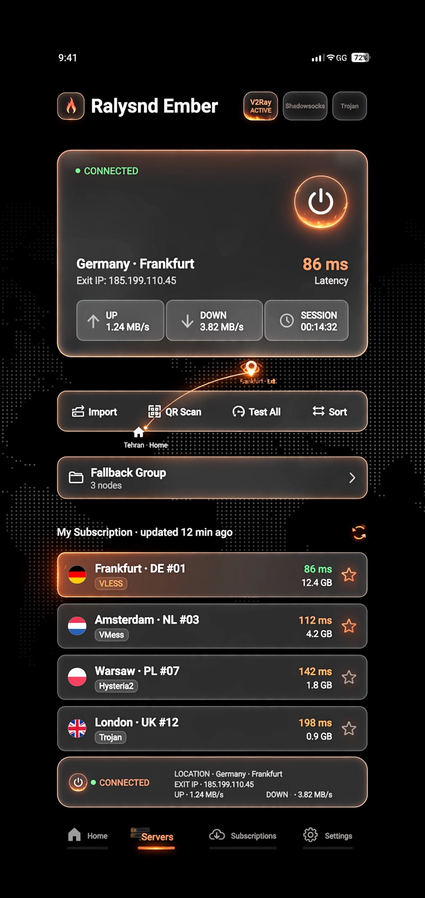
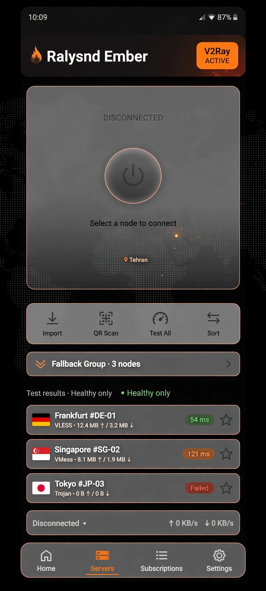
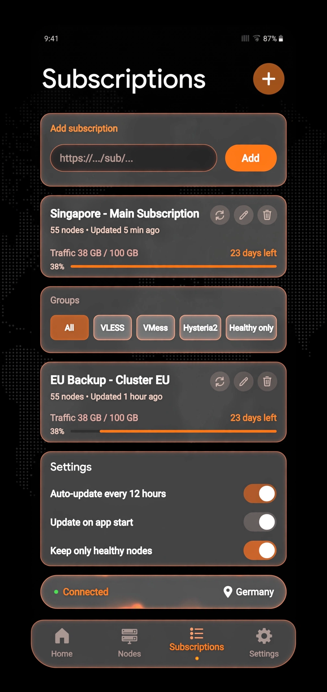
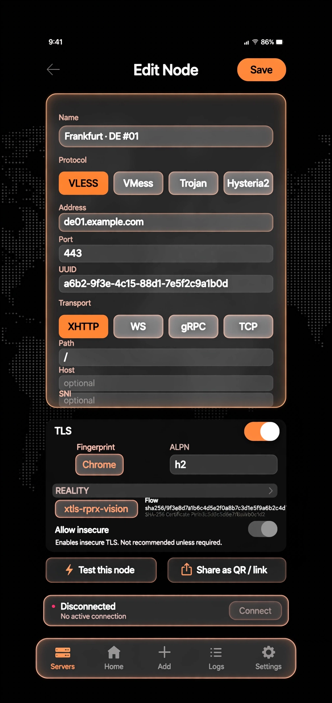
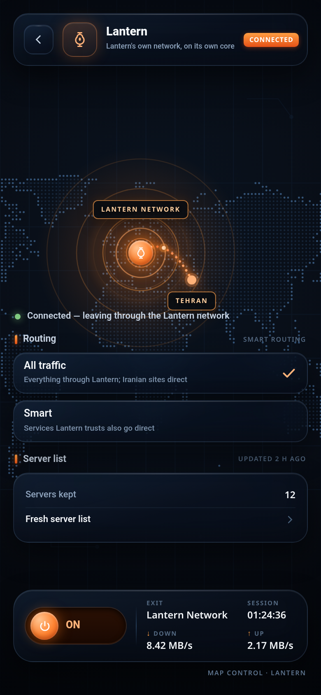
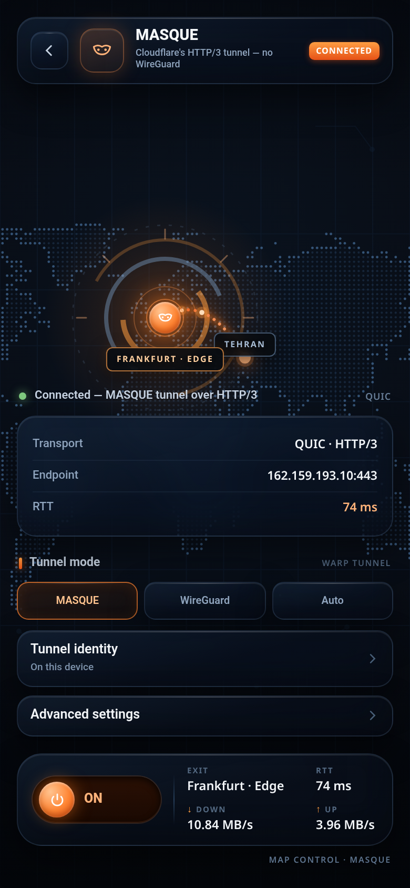

  

<h1 align="center">Ralysnd Ember</h1>

  A personal multi-engine VPN client for Android with a signature <b>Map Control</b> design — 
  black glass panels over a living dotted world map, one ember-orange accent, a glowing arc to your exit.

  <a href="https://github.com/Mojdee12/ralysnd-ember/releases/latest"><b>⬇ Download the latest build</b></a>
  &nbsp;·&nbsp; Android 7.0+ (arm64) &nbsp;·&nbsp; English UI

---

## دربارهٔ Ralysnd Ember (فارسی)

**Ralysnd Ember** یک کلاینت VPN شخصی و چندموتوره برای اندروید است؛ نه یک پروتکل، بلکه **۹ موتور در یک اپ** با یک زبان طراحی واحد به اسم **Map Control**: پنل‌های شیشه‌ای مشکی روی نقشهٔ جهانی نقطه‌ای زنده، با یک رنگ تاکیدی نارنجی (Ember) و یک کمان نورانی از خانه تا خروجی، وقتی وصلی.

هر موتوری که روی شبکه‌ات جواب بده انتخاب می‌کنی؛ کانفیگ‌ها، سابسکریپشن‌ها و آمار ترافیک هر موتور جدا نگه داشته می‌شه و موتورها می‌تونن زنجیره‌ای کار کنن (مثلاً V2Ray روی Psiphon) یا خودکار جای هم بیفتن.

**موتورها:** موزیلا (هستهٔ Kumiho با ورود OAuth)، V2Ray با هستهٔ Xray (VLESS / VMess / Trojan / Shadowsocks / WireGuard / Hysteria2 با REALITY و XHTTP)، سایفون (نردبان اتصال، فرانتینگ CDN، اسکنر آی‌پی تمیز)، لنترن، وایرگارد و AmneziaWG، اوپن‌وی‌پی‌ان، WARP کلادفلر، WARP MASQUE با ۶ پلهٔ رجیستر و یادگیری خودکار h3/h2، و آندرلی‌های DNSTT و wstunnel.

**قابلیت‌ها:** سابسکریپشن با آپدیت خودکار و پین‌کردن گواهی، گروه‌های فال‌بک بین موتوری، تست سندباکس کانفیگ، کیل‌سوییچ واقعی، اشتراک پروکسی در شبکهٔ محلی، آمار ترافیک برای هر کانفیگ، روتینگ آماده و قانون دلخواه، بکاپ و ری‌استور کامل، و آپدیت از داخل خود اپ (از بیلد 2075 اپ آخرین نسخه را از همین صفحهٔ گیت‌هاب می‌گیره).

**دانلود و نصب:** از بخش Releases آخرین نسخه را بگیر، فایل RalysndEmber2.apk را دانلود و نصب کن (اندروید یک بار اجازهٔ نصب از مرورگر/فایل‌ها را می‌خواد). اندروید 7 به بالا، arm64.

**نکتهٔ صادقانه:** کانفیگ‌های TUIC ذخیره و اشتراک‌گذاری می‌شن ولی هستهٔ Xray خروجی TUIC نداره، برای همین اپ صادقانه نشانشون می‌ده و تظاهر به اتصال نمی‌کنه.

---
## What is it?

Ralysnd Ember is not one VPN protocol — it is **nine engines in one app**, sharing one design
language and one home screen: a dotted world map that lights up with your home marker, the exit
pin, and a pulsing arc while you are connected. Pick the engine that works on your network;
Ember keeps your configs, subscriptions and traffic stats per engine, and can even chain
engines (for example V2Ray over Psiphon) or fall back across engines automatically.

## Screenshots

  
  
  

  
  
  

## Engines

| Engine | What it is |
|---|---|
| **Mozilla VPN** | Mozilla VPN via the Kumiho core — Fenix OAuth sign-in, serverless bootstrap |
| **V2Ray** | Full Xray-core client: VLESS / VMess / Trojan / Shadowsocks / WireGuard / Hysteria2, REALITY, XHTTP, gRPC, WebSocket, fragment, mux, fakeDNS |
| **Psiphon** | Psiphon with a connection ladder, CDN fronting, clean-IP scanner and per-network winner memory |
| **Lantern** | Lantern (Radiance) with CDN-fronted config fetch |
| **WireGuard** | WireGuard + AmneziaWG obfuscation, file import, per-peer stats |
| **OpenVPN** | OpenVPN profiles with an encrypted credential vault |
| **WARP** | Cloudflare WARP via warp-plus (SOCKS) |
| **WARP MASQUE** | Cloudflare MASQUE via the Aether core — six registration rungs incl. TLS-identity and tlshello modes, per-network memory, Auto h3/h2 learning |
| **Underlays** | DNSTT (DNS tunnel) and wstunnel (WebSocket) as chain underlays for the other engines |

## Highlights

- **Subscriptions** with auto-update, per-subscription certificate pinning and custom headers
- **Fallback groups** and cross-engine fallback chains — if one engine dies, the next takes over
- **Sandbox config test** — dry-run a config before you trust it
- **Real kill switch**, LAN proxy sharing, seamless server switching
- **Per-config traffic accounting** (persisted, resettable), real delay + speed tests
- **Routing presets + custom rules**, per-app proxy, smart auto-connect triggers
- **Backup / restore** of everything, transactional and atomic
- **In-app updates** — from build 2075 the app checks this repo's Releases and updates itself

## Download & install

1. Open the [**latest release**](https://github.com/Mojdee12/ralysnd-ember/releases/latest).
2. Download `RalysndEmber2.apk` (check the SHA-256 in the release notes if you like).
3. Install it — Android will ask once to allow installs from your browser/files app.

## Honest notes

- TUIC configs can be stored, edited and shared, but Xray-core has no TUIC outbound, so the
  app badges them and refuses to pretend they connect.
- This is a personal project, built for one person's networks (including heavily filtered
  ones). It is source-available here; the Android app in Releases is the supported artifact.
- The native engine cores ship prebuilt in `app/android/app/src/main/jniLibs/`; the Flutter
  app is in `app/` and the Go mobile core sources are in `core/`.

## License

See [LICENSE](LICENSE). Bundled engines keep their own licenses (the Aether/MASQUE core is
AGPL — its license text and source link are also shown inside the app under Settings).
