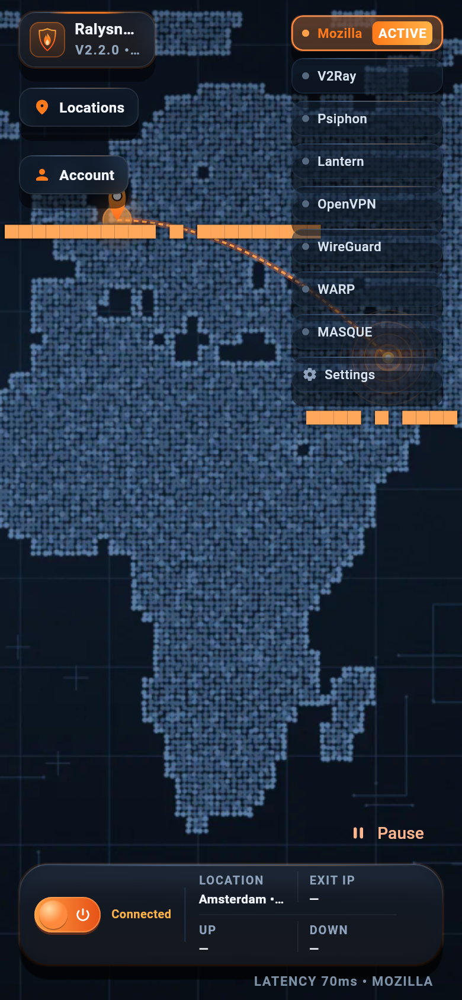
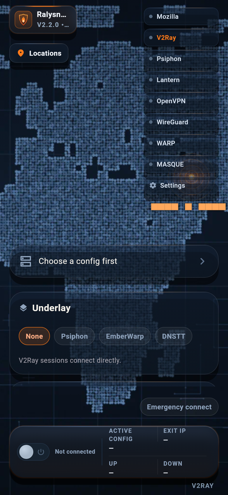
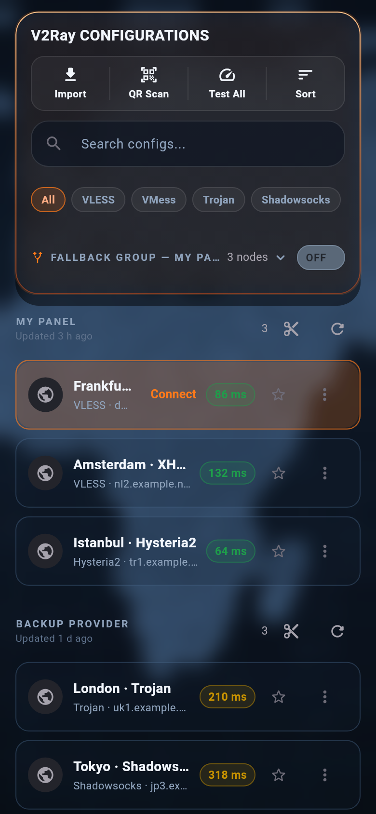
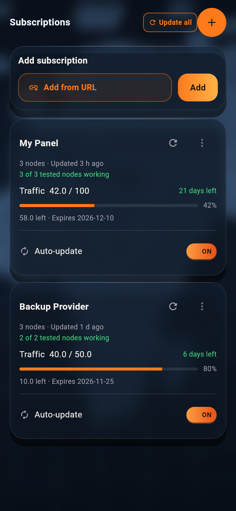
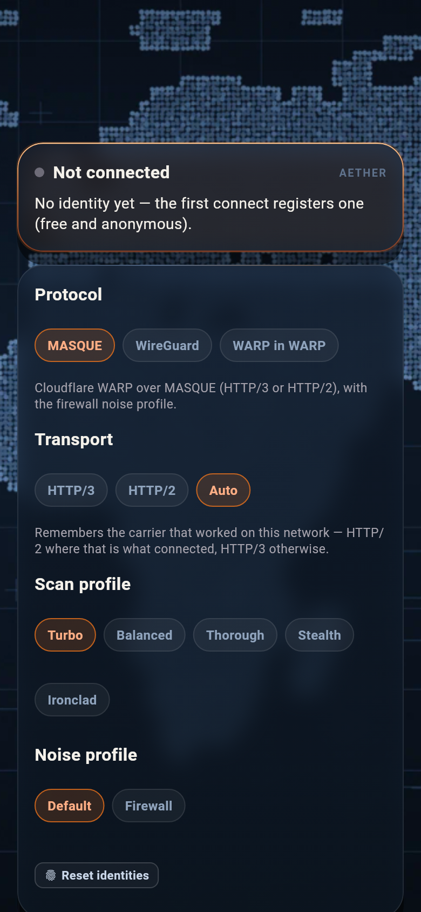
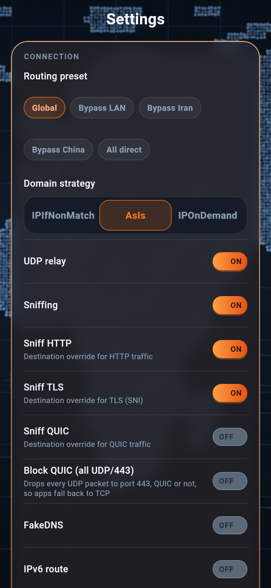
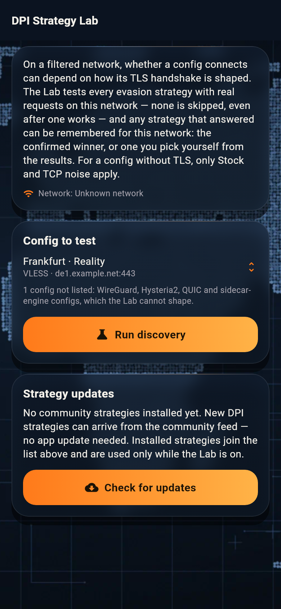

  

<h1 align="center">Ralysnd Ember</h1>

  A personal multi-engine VPN client for Android with a signature <b>Map Control</b> design — 
  black glass panels over a living dotted world map, one ember-orange accent, a glowing arc to your exit.

  <a href="https://github.com/Mojdee12/ralysnd-ember/releases/latest"><b>⬇ Download the latest build</b></a>
  &nbsp;·&nbsp; Version 2.2.0 (build 2117) &nbsp;·&nbsp; Android 8.0+ (arm64) &nbsp;·&nbsp; 15 UI languages

  <a href="#درباره-به-فارسی">🇮🇷 توضیحات فارسی در ادامهٔ همین صفحه</a>

---

## What is it?

Ralysnd Ember is not one VPN protocol — it is **eight engines in one app**, sharing one design
language and one home screen: a dotted world map that lights up with your home marker, the exit
pin, and a glowing arc while you are connected. Pick the engine that works on your network;
Ember keeps your configs, subscriptions and traffic stats per engine, can chain engines
(for example V2Ray over Psiphon), and can fall back across configs and engines automatically.
Exactly one tunnel is ever up: starting any engine cleanly stops the others first.

## Screenshots

The actual app UI — widget captures rendered from the shipped **build 2117** code itself
(real screens with sample configs), not mockups or design renders.

  
  
  

  
  
  

  

## Engines

| Engine | What it is |
|---|---|
| **Mozilla VPN** | Mozilla VPN via the Kumiho core — Firefox Account sign-in (native OAuth or browser), 33 locations with real through-tunnel delay tests, multi-account quota failover, Guardian pass renewal through the live tunnel |
| **V2Ray** | Full Xray-core client: VLESS / VMess / Trojan / Shadowsocks / WireGuard / Hysteria2 / SOCKS5 / HTTP, REALITY (incl. `mldsa65Verify`), XHTTP, gRPC, WebSocket, HTTPUpgrade, mKCP, QUIC, ECH, uTLS fingerprints, fragment, mux, fakeDNS |
| **Sidecar (sing-box / Mieru)** | TUIC, AnyTLS, Snell, NaiveProxy and Mieru profiles — which Xray cannot serve — connect through the bundled sidecar instead of being refused |
| **WireGuard** | WireGuard + AmneziaWG obfuscation (Jc/Jmin/Jmax, S1/S2, H1–H4, I1) on the WG Tunnel backend (amneziawg-go), per-peer handshake/traffic stats, profile MTU honoured, endpoint scanner |
| **OpenVPN** | .ovpn profiles (file or paste) with real LZO compression and an encrypted credential vault |
| **Lantern** | Lantern (Radiance) with CDN-fronted server list, cached-list fallback, private-server import |
| **Psiphon** | Psiphon in its own process: exit regions, transports, paired/fronted connection methods, bridge mode, custom CDN edges, per-network winner memory |
| **WARP** | Cloudflare WARP via warp-plus (EmberWarp) as a local SOCKS tunnel, with endpoint scanning |
| **WARP MASQUE** | Cloudflare MASQUE via the Aether core — WireGuard and MASQUE modes, multi-rung registration ladder (incl. TLS-identity and tlshello), per-network memory, automatic HTTP/3 ↔ HTTP/2 learning, aethernoize shaping |
| **Underlays & chains** | DNSTT (DNS tunnel) and wstunnel (WireGuard-over-WebSocket) underlays, V2Ray-over-underlay chaining, and a chain builder for named custom multi-hop chains |

## Features

*(default OFF)* marks toggles that ship off — Ember's extras never change v2rayNG-parity defaults behind your back.

### Connection & verification
- **Proven "Connected"** — a connect is only adopted after data-plane proof: an exit lookup through the tunnel for Xray, end-to-end validation for WARP/Aether; a fresh engine validation can no longer be vetoed by a slow re-probe
- **Honest exit verification** — if data flows but the exit trace never lands, the connection stands labelled **"exit unverified"** (persisted across restarts) instead of being torn down; an answered `warp=off` is still fatal
- **Real delay test & Test All** — measured proxied requests through throwaway cores (not bare TCP ping), bulk funnels with 1–8 parallelism, adjustable test timeout (3–20 s, default 8 s)
- **Sandbox config test** — dry-run a config before trusting it, without touching the live tunnel
- **Exit IP / endpoint display, leak test, filtering probe, service reachability checks** (Google, YouTube, Instagram, Telegram, X)
- **Emergency connect & quick presets** — one tap walks the engines until one proves a working connection
- **Endpoint scanners** — WireGuard endpoint scanner and Cloudflare clean-IP scanner; scanned endpoints can be pinned
- **Fallback groups, cross-engine fallback chain, auto-reconnect, stall watchdog, smart dial racing** *(all default OFF)*
- **Scheduled config health tests, auto-connect triggers** (reboot / untrusted Wi-Fi / network change) *(default OFF)*
- **Session data budget** (warns at 80%, disconnects at the cap) and a **tunnel MTU setting** (1280–1500) for every engine
- **Single-family warning** — a profile that covers only one IP family (e.g. an IPv6-only WARP config) says plainly which family stays outside the tunnel, and WireGuard exits are verified and stamped after connect

### Subscriptions & config management
- **Subscriptions with auto-update** (adjustable interval, on-launch refresh), traffic quota and expiry from provider headers, per-subscription custom headers and TLS certificate pinning
- **Import everywhere** — paste, clipboard, file, QR scan; share links for every supported protocol, raw JSON, and Clash YAML conversion
- **Share back out** as share link or QR; **full profile editor** for every field
- **Search, protocol filter, sort** (incl. by country and measured delay); **fastest prune** keeps a subscription's fastest N
- **Per-config traffic accounting** — persisted per config, shown on the row, resettable per config
- **Smart groups** — rule-based auto-grouping by country, protocol or name *(default OFF)*
- **Device pairing transfer** — your whole set travels to another device as QR codes carrying one sealed, password-encrypted payload (AES-256-GCM, PBKDF2 120k)

### Routing & DNS
- **Mozilla smart routing** — region presets (Iran, China, Russia, Afghanistan, Türkiye, Indonesia, Brazil), editable direct/block rules, downloadable routing lists that retry on failure instead of silently riding the proxy
- **V2Ray routing presets + your own custom rules**, routing by network type *(default OFF)*, **per-app proxy / bypass list**
- **Remote DNS over DoH** — default is v2rayNG's own Cloudflare DoH value, verbatim; **DoQ, DNS-over-TCP and DNSCrypt** transports also available
- **DNS group, DNS fallback, ad-blocking DNS, custom DNS hosts, provider DNS for server names, disable DNS cache** *(default OFF)*
- **fakeDNS** *(default OFF)*, per-protocol **sniffing controls** (HTTP / TLS / QUIC), **Block QUIC** *(default OFF)*, IPv6 route and domain strategy at v2rayNG parity, **Mux** *(default OFF)*
- **Hysteria2 port hopping works** — a profile's `mport` range is emitted to the sidecar; XHTTP `extra`, WebSocket early-data, TCP header camouflage and custom transport headers survive import and generation

### DPI Lab & anti-filter
- **DPI Strategy Lab** *(master toggle default OFF)* — discovers which traffic-shaping strategy defeats your network's DPI for a chosen config, with real requests on your network
- **Full-sweep discovery** — every candidate is tested to a measured result; a run never stops at the first winner
- **13 built-in strategies** — stock baseline, TLS fragment, unsafe fingerprint + ciphers, dialMode urgent byte, Mirage ClientHello split, first-byte fragment, three Zapret desync shapes, mixed-case SNI, ECH, the Unfilter shape, TCP noise
- **Honest verdicts** — works / answers-then-freezes / answered-but-unconfirmed / blocked; a strategy that freezes is never called a winner
- **Per-network memory (7-day trust) + manual pick** — file any answered strategy yourself with "Use this", journalled honestly as your pick
- **Remote strategy feed** — community strategies arrive as strictly validated data that can only recombine shipped shaping mechanisms — never code
- The same shaping layer (fragment, unsafe ciphers, dial-mode) is available to ordinary connections, not only inside the Lab

### Privacy & security
- **Kill switch** — blocks all traffic while the tunnel is down, including during reconnect waits
- **App lock (PIN)** — only the SHA-256 hash is stored; **biometric unlock** rides on top, the PIN always still works; failed attempts hit a persistent lockout cooldown
- **OpenVPN credential vault**, separate **proxy logins** for the LAN and local proxies
- **Show-public-IP toggle** *(default OFF)*; backups and sync payloads never carry the PIN hash or sync token

### Interface & Map Control
- **Map Control home** — black glass over a living dotted world map, home marker, exit pin, glowing arc; one ember-orange accent
- **Engine rail** — all engines one tap apart in one shell; bottom status bar with endpoint / exit-IP / up-down cells
- **15 languages** — Persian and Arabic render right-to-left; Persian localisation is complete (build 2117)
- Welcome flow, notification controls (live speeds, actions), bundled SVG country flags

### Diagnostics & maintenance
- **Diagnostics export** — one text bundle: connect journal, engine logs, settings state
- **Connect journal** — every engine's steps and failures with reasons, including watchdog, failover, Lab actions — and every Mozilla Guardian-pass renewal attempt and outcome, so a mid-session degradation leaves evidence by itself
- **Mozilla status honesty** — the shell shows Connected only when the core confirms it; repeated core errors surface as a lost connection instead of a frozen "Connected"
- Per-engine log viewers, live connections view, traffic history chart *(recording default OFF)*, battery usage report *(default OFF)*, settings-integrity surfacing

### Platform
- **Quick Settings tile**, **LAN proxy sharing** (SOCKS 10808 / HTTP 10809) *(default OFF)*, dedicated browser port *(default OFF)*
- **In-app updater** — checks this repo's Releases (stable + beta channels), verifies the downloaded release's digest before installing, sweeps stale downloads
- **Backup & restore** — one file, transactional, applied as an overlay; covers configs, subscriptions, settings and the OpenVPN / Psiphon / Aether sections
- **GitHub Gist sync** of the same encrypted backup; **launcher shortcuts** for starred configs *(default OFF)*
- **Desktop apps** — the same codebase ships Windows, macOS and Linux apps over the shared Mozilla core

## Download & install

1. Open the [**latest release**](https://github.com/Mojdee12/ralysnd-ember/releases/latest).
2. Download `RalysndEmber2.apk` (check the SHA-256 in the release notes if you like).
3. Install it — Android will ask once to allow installs from your browser/files app.

Current release: **2.2.0, build 2117** — Android 8.0+ (arm64).

## Honest notes

- This is a personal project, built for one person's networks (including heavily filtered
  ones). It is source-available here; the Android app in Releases is the supported artifact.
- The screenshots above are rendered from the app code itself (widget captures with sample
  configs) — what you see is the shipped UI.
- The native engine cores ship prebuilt in `app/android/app/src/main/jniLibs/`; the Flutter
  app is in `app/` and the Go mobile core sources are in `core/`.

## License

See [LICENSE](LICENSE). Bundled engines keep their own licenses (the Aether/MASQUE core is
AGPL — its license text and source link are also shown inside the app under Settings).

---

## درباره به فارسی

### Ralysnd Ember چیست؟

**Ralysnd Ember** یک پروتکل VPN نیست — **هشت موتور در یک اپ** است، با یک زبان طراحی و یک صفحهٔ خانهٔ مشترک: نقشهٔ جهانی نقطه‌ای که وقتی وصلی، با نشان خانهٔ تو، پین خروجی و یک کمان نورانی زنده می‌شود. هر موتوری که روی شبکه‌ات جواب بده انتخاب می‌کنی؛ امبر کانفیگ‌ها، سابسکریپشن‌ها و آمار ترافیک هر موتور را جدا نگه می‌دارد، می‌تواند موتورها را زنجیره‌ای کند (مثلاً V2Ray روی سایفون) و خودکار بین کانفیگ‌ها و موتورها فال‌بک بزند. همیشه فقط یک تونل بالاست: شروع هر موتور، بقیه را اول تمیز خاموش می‌کند.

### اسکرین‌شات‌ها

رابط واقعی خود اپ — کپچرهای ویجتی که از کد منتشرشدهٔ **بیلد ۲۱۱۷** رندر شده‌اند (صفحه‌های واقعی با کانفیگ‌های نمونه)، نه ماکاپ و نه رندر طراحی. گالری در بخش انگلیسی بالای همین صفحه است.

### موتورها

- **موزیلا (هستهٔ Kumiho)** — با حساب فایرفاکس وصل می‌شود (ورود OAuth داخل اپ یا ورود با مرورگر)؛ ۳۳ لوکیشن با تست تأخیر واقعی از داخل تونل، چند حساب با جابه‌جایی خودکار وقتی حجم حساب فعال به آستانه (پیش‌فرض ۹۵٪) نزدیک شود، و تمدید پس Guardian از داخل تونل زنده.
- **V2Ray (هستهٔ Xray)** — کلاینت کامل Xray: ‏VLESS ،VMess ،Trojan ،Shadowsocks ،WireGuard ،Hysteria2 ،SOCKS5 و HTTP؛ ‏REALITY (از جمله کلید پس‌کوانتومی `mldsa65Verify`)، ‏XHTTP ،gRPC ،WebSocket ،HTTPUpgrade ،mKCP ،QUIC، ‏ECH، فینگرپرینت uTLS، فرگمنت، mux و fakeDNS.
- **سایدکار (sing-box / Mieru)** — کانفیگ‌های TUIC ،AnyTLS ،Snell ،NaiveProxy و Mieru که Xray ندارد، از سایدکار داخلی وصل می‌شوند.
- **وایرگارد (بک‌اند WG Tunnel)** — وایرگارد و مبهم‌سازی AmneziaWG (پکت‌های جانک Jc/Jmin/Jmax، ‏S1/S2، هدرهای H1 تا H4 و پکت I1) روی بک‌اند WG Tunnel؛ آمار زندهٔ هندشیک و ترافیک هر پیر، MTU خود پروفایل اعمال می‌شود، اسکنر اندپوینت.
- **OpenVPN** — پروفایل‌های ‎.ovpn‎ (فایل یا چسباندن) با فشرده‌سازی واقعی LZO و گاوصندوق رمزگذاری‌شدهٔ اعتبار.
- **لنترن** — لنترن (Radiance) با لیست سرور فرانت‌شده از CDN، لیست کش‌شدهٔ جایگزین و واردکردن سرور خصوصی.
- **سایفون** — در پردازهٔ جدا: انتخاب ریجن خروجی، ترنسپورت‌ها، روش‌های اتصال جفت‌شده/فرانت‌شده، حالت بریج، اج‌های CDN دلخواه و حافظهٔ برنده برای هر شبکه.
- **WARP کلادفلر (EmberWarp)** — ‏WARP از هستهٔ warp-plus به‌صورت تونل SOCKS محلی، با اسکن اندپوینت و پین‌کردن اندپوینت اسکن‌شده.
- **WARP MASQUE (هستهٔ Aether)** — ‏MASQUE کلادفلر: حالت‌های WireGuard و MASQUE، نردبان رجیستر چندپله‌ای (از جمله TLS-identity و tlshello)، حافظهٔ هر شبکه، یادگیری خودکار HTTP/3 و HTTP/2 و شکل‌دهی aethernoize.
- **آندرلی‌ها و زنجیره‌ها** — آندرلی DNSTT (تونل DNS) و wstunnel (وایرگارد روی WebSocket)، زنجیرهٔ V2Ray روی آندرلی، و چین‌بیلدر برای زنجیره‌های چندپرشی نام‌دار.

### ویژگی‌ها

مواردی که با *(پیش‌فرض خاموش)* مشخص شده‌اند، کلیدهایی‌اند که خاموش عرضه می‌شوند — اضافات امبر هیچ‌وقت پیش‌فرض‌های هم‌تراز v2rayNG را پشت سرت عوض نمی‌کنند.

**اتصال و راستی‌آزمایی**
- «متصل» اثبات‌شده — اتصال فقط بعد از اثبات ردشدن دیتا قبول می‌شود: لوکاپ خروجی از داخل تونل برای Xray و اعتبارسنجی سرتاسری برای WARP/Aether؛ اعتبارسنجی تازهٔ موتور دیگر با تایم‌اوت یک پروب تکراری روی اندپوینت کند وتو نمی‌شود.
- راستی‌آزمایی صادقانهٔ خروجی — اگر دیتا رد شود ولی تریس خروجی نیاید، اتصال با برچسب «خروجی تأییدنشده» وصل می‌ماند (با ری‌استارت هم نمی‌پرد)؛ جواب warp=off هنوز کشنده است.
- تست تأخیر واقعی و تست همه — درخواست واقعی از داخل پروکسی با هستهٔ موقت (نه پینگ سادهٔ TCP)، تست پلکانی با موازی‌سازی ۱ تا ۸ و مهلت قابل تنظیم (۳ تا ۲۰ ثانیه، پیش‌فرض ۸).
- تست سندباکس کانفیگ، نمایش آی‌پی خروجی و اندپوینت، تست نشت، پروب فیلترینگ و چک دسترسی سرویس‌ها (Google ،YouTube ،Instagram ،Telegram و X).
- اتصال اضطراری و پریست‌های سریع — با یک لمس موتورها به‌ترتیب امتحان می‌شوند تا یکی اتصال سالم را ثابت کند.
- اسکنر اندپوینت وایرگارد و اسکنر آی‌پی تمیز کلادفلر، با امکان پین‌کردن اندپوینت.
- گروه‌های فال‌بک، زنجیرهٔ فال‌بک بین موتوری، اتصال مجدد خودکار، واچ‌داگ هنگ و مسابقهٔ دایل هوشمند *(همه پیش‌فرض خاموش)*.
- تست سلامت زمان‌بندی‌شده و تریگرهای اتصال خودکار (ریبوت / وای‌فای نامطمئن / تغییر شبکه) *(پیش‌فرض خاموش)*.
- بودجهٔ حجم سشن (هشدار در ۸۰٪ و قطع سر سقف) و تنظیم MTU تونل (۱۲۸۰ تا ۱۵۰۰) برای همهٔ موتورها.
- هشدار تک‌خانواده — پروفایلی که فقط یک خانوادهٔ آی‌پی را می‌پوشاند (مثل کانفیگ WARP فقط-IPv6) رک می‌گوید کدام خانواده بیرون تونل می‌ماند؛ خروجی وایرگارد بعد از اتصال بررسی و روی پروفایل مهر می‌شود.

**سابسکریپشن و مدیریت کانفیگ**
- سابسکریپشن با آپدیت خودکار (بازهٔ قابل تنظیم و تازه‌سازی هنگام اجرا)، نمایش حجم و انقضا از هدر ارائه‌دهنده، هدر دلخواه و پین گواهی TLS برای هر سابسکریپشن.
- واردکردن از همه‌جا — چسباندن لینک، کلیپ‌بورد، فایل یا اسکن QR؛ لینک همهٔ پروتکل‌ها، JSON خام و تبدیل Clash YAML.
- اشتراک‌گذاری دوباره با لینک یا QR و ویرایشگر کامل پروفایل برای همهٔ فیلدها.
- جستجو، فیلتر پروتکل و مرتب‌سازی (از جمله بر اساس کشور و تأخیر)؛ هرس سریع‌ترین‌ها بعد از تست همه.
- حسابداری ترافیک هر کانفیگ — ماندگار، روی ردیف پروفایل، با ریست جدا برای هر کانفیگ.
- گروه‌های هوشمند قانون‌محور (کشور، پروتکل یا الگوی نام) *(پیش‌فرض خاموش)*.
- انتقال جفت‌سازی بین دستگاه‌ها — کل مجموعه با دنباله‌ای از QR و یک محمولهٔ مهروموم‌شده و رمزگذاری‌شده با رمز تو (AES-256-GCM و PBKDF2 ‏۱۲۰هزار).

**روتینگ و DNS**
- روتینگ هوشمند موزیلا — پریست‌های منطقه‌ای (ایران، چین، روسیه، افغانستان، ترکیه، اندونزی، برزیل)، قانون‌های مستقیم/مسدود قابل ویرایش و لیست‌های روتینگ قابل دانلود که اگر دانلودشان شکست بخورد بعداً دوباره تلاش می‌شود.
- پریست‌های روتینگ V2Ray و قانون‌های دلخواه تو، روتینگ بر اساس نوع شبکه *(پیش‌فرض خاموش)* و پروکسی برای هر اپ (لیست بای‌پس).
- DNS راه‌دور روی DoH — پیش‌فرض دقیقاً مقدار خود v2rayNG است (DoH کلادفلر)؛ ترنسپورت‌های DoQ، ‏DNS روی TCP و DNSCrypt هم هست.
- گروه DNS، ‏DNS جایگزین، DNS ضد تبلیغ، هاست‌های DNS دلخواه، DNS ارائه‌دهنده برای نام سرورها و خاموش‌کردن کش DNS *(پیش‌فرض خاموش)*.
- ‏fakeDNS *(پیش‌فرض خاموش)*، کنترل اسنیفینگ جدا برای HTTP ،TLS و QUIC، بلاک QUIC *(پیش‌فرض خاموش)*، روت IPv6 و استراتژی دامنه هم‌تراز v2rayNG و Mux *(پیش‌فرض خاموش)*.
- پورت‌هاپینگ Hysteria2 واقعاً کار می‌کند — بازهٔ `mport` به سایدکار داده می‌شود؛ ‏extra ‏XHTTP، دیتای زودهنگام WebSocket، استتار هدر TCP و هدرهای دلخواه ترنسپورت در واردکردن و ساختن حفظ می‌شوند.

**لب DPI و ضدفیلتر**
- لب استراتژی DPI *(کلید اصلی پیش‌فرض خاموش)* — کشف می‌کند کدام استراتژی شکل‌دهی ترافیک، DPI شبکه‌ات را برای کانفیگ انتخاب‌شده می‌زند، با درخواست واقعی روی شبکهٔ خودت.
- سوییپ کامل — همهٔ کاندیدها تا نتیجهٔ اندازه‌گیری‌شده تست می‌شوند؛ اجرا سر اولین برنده نمی‌ایستد.
- ۱۳ استراتژی داخلی — خط پایهٔ استاک، فرگمنت TLS، فینگرپرینت ناامن + سایفرها، بایت فوری dialMode، برش Mirage برای ClientHello، فرگمنت بایت اول، سه شکل Zapret، ‏SNI با حروف مخلوط، ECH، شکل Unfilter و نویز TCP.
- حکم‌های صادقانه — کار می‌کند / جواب می‌دهد بعد فریز می‌شود / جواب داده ولی تأیید نشده / مسدود؛ استراتژی فریزکننده هیچ‌وقت «برنده» نامیده نمی‌شود.
- حافظهٔ هر شبکه (اعتماد ۷روزه) + انتخاب دستی — هر استراتژی جواب‌داده‌ای را خودت با «Use this» ثبت می‌کنی و انتخابت صادقانه به نام خودت ثبت می‌شود.
- فید استراتژی راه‌دور — استراتژی‌های جامعه داده‌ای با اعتبارسنجی سخت‌گیرانه‌اند که فقط مکانیزم‌های موجود اپ را دوباره ترکیب می‌کنند — هیچ‌وقت کد نیستند.
- همان لایهٔ شکل‌دهی برای اتصال‌های معمولی هم هست، نه فقط داخل لب.

**حریم خصوصی و امنیت**
- کیل‌سوییچ — وقتی تونل پایین است همهٔ ترافیک بسته است، از جمله در مدت انتظار اتصال مجدد.
- قفل اپ (PIN) — فقط هش SHA-256 ذخیره می‌شود؛ بازکردن بیومتریک روی PIN سوار می‌شود و PIN همیشه کار می‌کند؛ تلاش‌های اشتباه به کول‌داون قفل ماندگار می‌رسند.
- گاوصندوق اعتبار OpenVPN و لاگین‌های جدا برای پروکسی LAN و پروکسی محلی.
- کلید نمایش آی‌پی عمومی *(پیش‌فرض خاموش)*؛ بکاپ و سینک هیچ‌وقت هش PIN یا توکن سینک را با خود نمی‌برند.

**رابط و Map Control**
- هوم Map Control — شیشهٔ مشکی روی نقشهٔ جهانی نقطه‌ای زنده، نشان خانه، پین خروجی و کمان نورانی؛ یک رنگ تاکیدی نارنجی امبر.
- ریل موتورها — همهٔ موتورها در یک پوسته یک لمس فاصله دارند؛ نوار وضعیت پایین با سلول‌های اندپوینت / آی‌پی خروجی / آپلود و دانلود.
- ۱۵ زبان — فارسی و عربی راست‌به‌چپ رندر می‌شوند؛ فارسی اپ کامل است (بیلد ۲۱۱۷).
- فلو خوش‌آمد، کنترل‌های نوتیفیکیشن (سرعت زنده و اکشن‌ها) و پرچم‌های SVG داخلی کشورها.

**عیب‌یابی و نگهداری**
- خروجی عیب‌یابی — یک بستهٔ متنی واحد: ژورنال اتصال، لاگ موتورها و وضعیت تنظیمات.
- ژورنال اتصال — قدم‌ها و شکست‌های هر موتور با دلیل، از جمله کارهای واچ‌داگ، فال‌بک و لب — و هر تلاش تمدید پس Guardian موزیلا و نتیجه‌اش، تا افت وسط سشن خودش مدرک بگذارد.
- صداقت وضعیت موزیلا — پوسته فقط وقتی «متصل» نشان می‌دهد که هسته تأیید کند؛ خطاهای تکراری هسته به‌صورت قطع‌شده دیده می‌شوند، نه «متصل» یخ‌زده.
- بینندهٔ لاگ هر موتور، نمای اتصال‌های زنده، نمودار تاریخچهٔ ترافیک *(ضبط پیش‌فرض خاموش)*، گزارش مصرف باتری *(پیش‌فرض خاموش)* و آشکارسازی سلامت فایل تنظیمات.

**پلتفرم**
- کاشی تنظیمات سریع، اشتراک پروکسی در شبکهٔ محلی (SOCKS ‏۱۰۸۰۸ و HTTP ‏۱۰۸۰۹) *(پیش‌فرض خاموش)* و پورت جدا برای مرورگر *(پیش‌فرض خاموش)*.
- آپدیتر داخل اپ — ریلیزهای همین گیت‌هاب را چک می‌کند (کانال پایدار و بتا)، قبل از نصب دایجست ریلیز دانلودشده را بررسی می‌کند و دانلودهای کهنه را پاک می‌کند.
- بکاپ و ری‌استور — یک فایل، تراکنشی و لایه‌ای؛ کانفیگ‌ها، سابسکریپشن‌ها، تنظیمات و بخش‌های OpenVPN، سایفون و Aether را پوشش می‌دهد.
- سینک همان بکاپ رمزگذاری‌شده با GitHub Gist خصوصی خودت و شورت‌کات‌های لانچر برای کانفیگ‌های ستاره‌دار *(پیش‌فرض خاموش)*.
- اپ‌های دسکتاپ — همان کدبیس اپ‌های Windows ،macOS و Linux را روی هستهٔ مشترک موزیلا می‌دهد.

### دانلود و نصب

۱. آخرین ریلیز را از [صفحهٔ ریلیزها](https://github.com/Mojdee12/ralysnd-ember/releases/latest) باز کن.
۲. فایل `RalysndEmber2.apk` را دانلود کن (اگر خواستی SHA-256 داخل یادداشت ریلیز را چک کن).
۳. نصبش کن — اندروید یک بار اجازهٔ نصب از مرورگر/فایل‌ها را می‌خواهد.

نسخهٔ فعلی: **۲.۲.۰، بیلد ۲۱۱۷** — اندروید ۸ به بالا (arm64).

### نکته‌های صادقانه

- این یک پروژهٔ شخصی است، ساخته‌شده برای شبکه‌های یک نفر (از جمله شبکه‌های به‌شدت فیلترشده). سورس اینجاست؛ آرتیفکت پشتیبانی‌شده، اپ اندروید داخل Releases است.
- اسکرین‌شات‌های این صفحه از کد خود اپ رندر شده‌اند (کپچر ویجتی با کانفیگ نمونه) — چیزی که می‌بینی همان رابط منتشرشده است.
- هسته‌های بومی موتورها به‌صورت آماده در `app/android/app/src/main/jniLibs/` هستند؛ اپ فلاتر در `app/` و سورس هستهٔ موبایل Go در `core/` است.

### لایسنس

[LICENSE](LICENSE) را ببین. موتورهای همراه لایسنس خودشان را نگه می‌دارند (هستهٔ Aether/MASQUE ‏AGPL است — متن لایسنس و لینک سورسش داخل خود اپ، در تنظیمات، هم نشان داده می‌شود).

